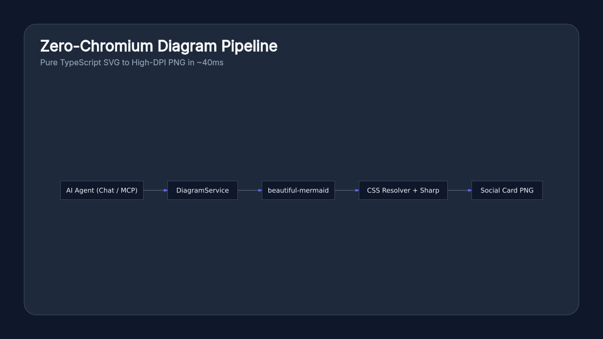
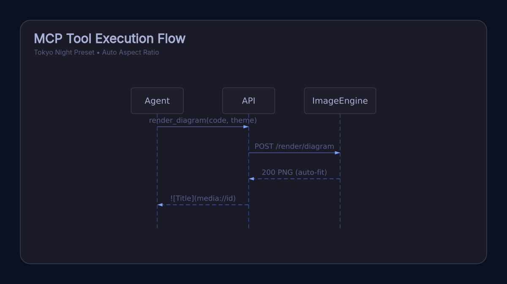
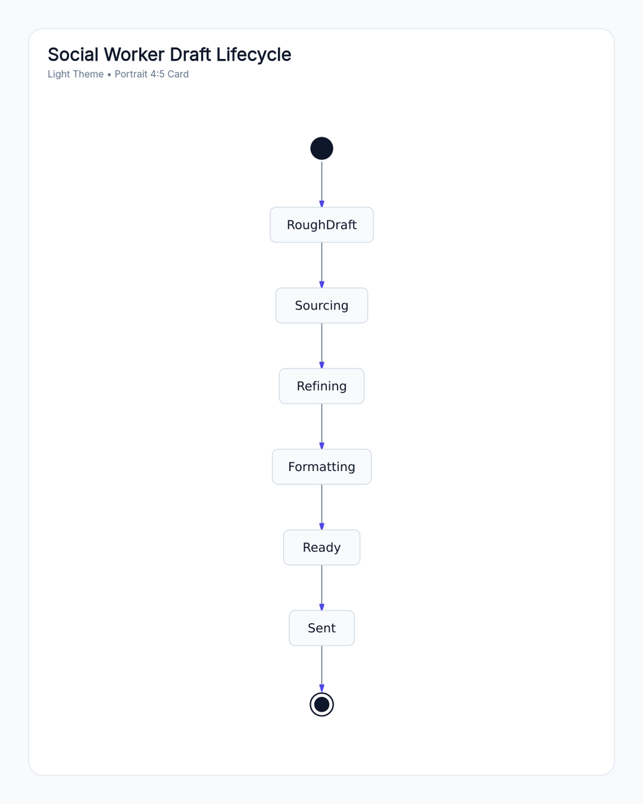

We just shipped agentic Mermaid diagram rendering in **Social Worker** — with zero headless Chromium, pure TypeScript rendering via `beautiful-mermaid`, and social-ready cards generated in roughly **40ms**.

## How It Works

Instead of spinning up a heavy Puppeteer or Playwright browser process inside Docker just to rasterize diagrams, our `image-engine` microservice renders standard Mermaid definitions straight to SVG in pure TypeScript, resolves CSS custom properties for `librsvg`, and composites the result onto a framed high-DPI card with Sharp and `@napi-rs/canvas`.

Agents in both the in-app Chat composer and the MCP server can invoke `render_diagram` with standard Mermaid syntax — including `flowchart`, `sequence`, `state`, `class`, and `erDiagram` — and immediately get back a media asset ready to embed in threads or blog posts.

## Aspect Ratios, Themes, and Presets

To match the rest of Social Worker's visual tooling (like `render_chart`), the diagram pipeline supports:

- **Automatic aspect-ratio selection**: Picks `16:9`, `1:1`, or `4:5` based on the rendered diagram's natural dimensions.
- **Dark and light card framing**: Consistent typography, padding, and titles across charts and diagrams.
- **15 built-in presets**: Including `tokyo-night`, `dracula`, and `nord`.

